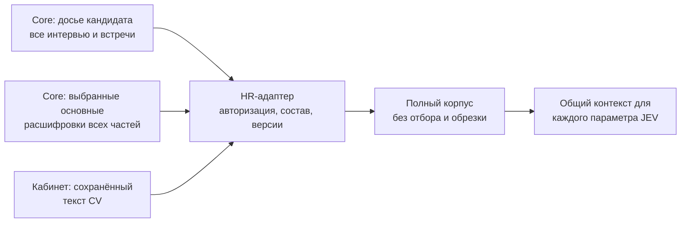

# Подключение существующего сборщика

26 октября 2026. Реализован HR-адаптер и проверен операторский путь на живом YC.
Сервисы не перевыкладывались. Реальные оценки, ASR и подключение Верстака не запускались.



## Что именно подключено

- `CandidateCorpusCollector` в `interface-lab/server/assessment_corpus.py` принимает
  уже настроенный `CoreClient`, функцию чтения CV и обязательную проверку доступа.
- Через существующий `GET /v1/candidates/{id}/dossier` получает все связанные
  `interviews[]` и `meetings[]`. Новый поиск интервью или второй реестр не создан.
- Через `CoreClient.primary_transcripts(kind,id)` читает выбранные Core версии,
  проверяет владельца, поколение, ревизию, immutable ID/hash и все части записи.
  Старая Zoom-расшифровка не подставляется вместо pending/failed primary.
- `SQLiteResumeReader` читает `cp_resumes.text_content` в фиксированной HR DB,
  открытой `mode=ro` + `query_only`. Чтение выполняется после авторизации кандидата
  и успешного dossier. Исходные байты CV нужны только для локального SHA-256;
  они не передаются оценщику. Dossier не расширялся приватным текстом резюме.
- CV передаётся одной текстовой единицей; сегменты расшифровки — один к одному,
  с исходным порядком, пробелами, Unicode, speaker и таймкодами. Роль неизвестна,
  если источник не даёт достоверной связи с участником. Метки говорящих не угадываются.
- Все источники входят в один `state` запроса. Параметры отличаются вопросом и
  своими уровнями, а не доступным текстом. Source IDs и версии позволяют найти
  оригинал; raw storage references остаются в приватном манифесте HR-адаптера.

## Целостность и готовность

`collect(candidate_id)` делает два чтения полного состава и возвращает:

```text
candidate_id, status=ready|blocked, revision, corpus, manifest
```

При `blocked` значение `corpus` равно `None`; частичный текст нельзя случайно
передать дальше как готовый. В манифесте остаются конкретные причины и весь состав.
До/после чтений вызывается серверная проверка доступа. Смена CV, основного текста,
состава записей, поколения или выбора между чтениями отклоняет снимок.

Готовность проверяется по всем видимым recording ID. `primary.status=ready` для
одной части не скрывает вторую без primary. Незавершённый разговор с уже готовым
промежуточным файлом также блокируется. Порядок частей берётся из инвентаря Core,
не из сортировки случайных ID. Альтернативные ракурсы/аудиодорожки без явной связи
эквивалентности не схлопываются по сходству текста или длительности.

Отсутствующий CV отмечается `absent`; существующий CV без извлечённого текста —
ошибка готовности, а не повод использовать краткое описание из профиля. Отсутствие
интервью видно в манифесте. Запланированные/отменённые встречи без материалов —
`not_conducted`; подтверждённое сборщиком отсутствие записи — `not_recorded`.
Необнаруженные материалы, pending/error primary и отзыв доступа не маскируются.

Хеш Core проверяется по `{raw_ref, segments, metadata}`. Хеш нормализованного корпуса
вычисляется отдельно. Статус ASR `coverage=not_independently_verified` сохраняется
как предупреждение о непроверенной полноте распознавания; это не заявленная обрезка.
Явные `partial/truncated/incomplete` блокируют сборку.

Гарантия сохранности начинается с **уже сохранённого текста**. Этот адаптер не
доказывает, что предыдущий PDF-парсер прочёл все страницы или ASR распознал каждое
произнесённое слово. Он не исправляет и не переписывает эти исходники.

## Использование в будущем адаптере Верстака

```python
collector = CandidateCorpusCollector(
    existing_core_client,
    portal_owned_resume_reader,
    authorize=normal_candidate_access_check,
)
snapshot = collector.collect(candidate_id)
if snapshot["status"] != "ready":
    return source_readiness_response(snapshot["manifest"])

# Только после согласования шкал и разрешённого запуска оценки:
snapshot = collector.revalidate(snapshot)
body = {"corpus": snapshot["corpus"], "rubric": approved_rubric}
# POST /v1/assessments; сохранить manifest/revision вместе со ссылкой на run_id.
# Перед публикацией результата повторить collector.revalidate(snapshot).
```

Это пример интеграции, а не подключённый браузерный маршрут. Общий service token
Core не заменяет проверку принадлежности кандидата текущему пользователю.
Полномочия и версии надо повторно проверять непосредственно перед отправкой и
публикацией: два HTTP-чтения не создают распределённую транзакцию или вечную гарантию
неизменности. При изменении источников старый результат остаётся историческим.
Сохранять приватный манифест и реализовать эту проверку публикации должен HR-адаптер;
текущий оценщик не получает доступ к базе кандидатов.

## Проверка на YC

На outreach прочитаны существующий Core HTTP и существующая HR SQLite. Временный
каталог с проверяемым кодом удалён после проверки. Состояние сервисов не менялось.
Для каждого корпуса построен настоящий запрос нового `prepare` с **15 синтетическими
вопросами проверки передачи**. Это не наши рабочие шкалы; запрос в JEV не отправлялся.

| Кандидат | Текст CV, символов | Сегментов интервью | Источников | Общий текст, символов | Все 15 вопросов видят весь корпус |
|---|---:|---:|---:|---:|---|
| Айгерим | 1 364 | 138 | 2 | 21 937 | Да |
| Виталий Багин | 14 355 | 64 | 2 | 23 536 | Да |
| Елена Рыбкина | 9 782 | 114 | 2 | 32 905 | Да |

У каждого в текущем досье одно интервью, один выбранный текст и CV. Сценарий
нескольких интервью/частей/встреч проверен отдельно синтетическими тестами.
Во всех трёх ASR сохраняет `not_independently_verified`; качество речи не проверялось.
Срез с ID, выбранными transcript hashes, размерами и причинами:
`output/research/core-redesign-20261026/collector-read-check.json`.
В нём нет текста CV/интервью или ключей. Проверяющий сценарий рядом:
`collector_read_check.py`.

89 тестов нового ядра прошли, включая 18 тестов нового сборщика: точность текста,
полный корпус для 15 вопросов, несколько интервью и частей, смена источников,
отзыв доступа, отсутствие части, живой разговор, готовность и read-only SQLite.

## Операторская команда

Серверная конфигурация: `ASSESSMENT_HR_RUNTIME` — установленный каталог с
`core_source_client.py`; `ASSESSMENT_HR_DATABASE` — фиксированная HR DB;
`HR_MATERIALS_CORE_URL/KEY` — существующий клиент Core. Ключи не передаются в argv.

```bash
PYTHONPATH=services/assessment-core python3 services/assessment-core/collect_hr.py \
  --candidate-id APPROVED_CANDIDATE_ID
```

Команда печатает только состав, хеши и готовность, не отправляет текст в модель,
не создаёт задачу оценки и не запускает ASR. Код выхода 0 — всё готово, 3 —
неполнота/ошибка отдельного кандидата, 2 — ошибка конфигурации. Это доверенный
операторский инструмент, не замена авторизации публичного HTTP API.

Лимиты контекста JEV и рабочий каталог шкал остаются следующей проверкой до
реального прогона. Размер JSON в байтах не выдаётся за количество токенов.
