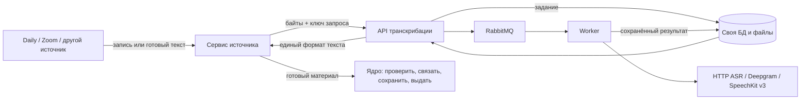

# Отдельный сервис транскрибации

Сервис принимает готовый текст или байты записи по HTTP. Он не знает кандидатов, вакансии, Daily/Zoom, API ядра и их ключи. Его можно выпускать отдельно от ядра и сервиса звонка.



Готовый VTT/SRT/JSON нормализуется сразу, без RabbitMQ и ASR. Для аудио/видео API сохраняет вход и задание; worker обращается к явно настроенному движку. Результат остаётся в собственной БД сервиса, а источник доставляет его в ядро. Успех распознавания и доставка в ядро — разные события.

**ASR по умолчанию выключен.** Можно настроить прежний HTTP backend, `deepgram` либо `yandex_speechkit`. Первый live provider — Deepgram, SpeechKit остаётся отдельным адаптером. Аудиозапрос без конфигурации получает 503. SpeechKit v3 использует безопасное локальное извлечение WAV, приватный staging S3 и сохранённый operation ID для восстановления. Реальные интервью в тестах не отправлялись.

- [Контракт API](CONTRACT.md): запросы, единый формат, повтор и неопределённый исход.
- [Запуск и выкатка](DEPLOYMENT.md): отдельный контейнер, состояние, секреты, порядок переключения.
- [Клиент источника](examples/source_client.py): upload → poll → result. Доставку в ядро реализует источник.

## Что выделено из прежнего кода

Парсер `interface-lab/server/materials_transcripts.py` перенесён в `src/md_transcription/normalization.py`; зависимость `pysubs2` теперь принадлежит сервису. В старом collector оставлен HTTP-клиент с прежней функцией `normalize_transcript`. Он не распознаёт аудио и не содержит локальный fallback. Сбой сервиса сохраняет исходный материал и переводит работу в повтор; повреждённый текст отклоняется отдельно.

Новый независимый сервис источника использует HTTP-контракт напрямую. Импорт пакета транскрибации в ядро не требуется. В двух старых интеграционных тестах парсер подключается как тестовая зависимость, чтобы отдельно проверять работу хранилища и collector.

## На чём собран сервис

Готовые библиотеки закрывают HTTP, валидацию, очередь, SQL и субтитры: FastAPI/Starlette/Pydantic/Uvicorn, Celery, SQLAlchemy, aiohttp, pysubs2. Их версии и транзитивные зависимости закреплены с хешами в `requirements.lock`. Собственный код отвечает за контракт результата, учёт владельца задания и восстановление после сбоев.

Решение о вынесении тяжёлой работы из HTTP-процесса опирается на [FastAPI](https://fastapi.tiangolo.com/tutorial/background-tasks/); потоковый приём — на [Starlette](https://www.starlette.io/requests/); повторная доставка — на [семантику задач Celery](https://docs.celeryq.dev/en/stable/userguide/tasks/). Для границы внешнего ASR изучены [Speaches](https://github.com/speaches-ai/speaches) и [Whisper ASR Webservice](https://github.com/ahmetoner/whisper-asr-webservice). Это примеры устройства inference API, а не выбранный нами движок. Полная карта заимствований и проверка библиотек приведены в обсуждении до реализации.

## Проверка

CPython 3.12; из этой папки после установки зависимостей:

```sh
PYTHONPATH=src python -B -m unittest discover -s tests -v
```

Тесты поднимают настоящий HTTP API отдельным процессом, загружают файл, запускают отдельный worker и проверяют результат после остановки тестового HTTP ASR и перезапуска API. Также проверяются изоляция клиентов, повторная доставка, конфликты входа, lease, неизвестный исход, ограничения размера и восстановление после оборванной загрузки.

Это проверка протокола и сохранности результата с искусственным ASR. Она не доказывает качество распознавания реальных интервью или работу RabbitMQ в production. Docker-образ и live-выкатка проверяются отдельно при интеграции.

## SpeechKit v3

Оператор выбирает `TRANSCRIPTION_BACKEND_KIND=yandex_speechkit`. Новые задания закрепляют модель `general`, язык `ru-RU`, конфигурацию декодирования и revision. Speaker labeling выключен: поставщик поддерживает максимум два голоса в mono, а метка канала не означает имя или роль участника. Каналы доступны в provider metadata, `segments[].speaker` остаётся null.

FFmpeg выбирает первый audio stream и преобразует его в mono PCM WAV 16 kHz, без обрезки. Проверяются исходная и полученная длительность (максимум 4 часа), размер, disk budget, CPU/time limits; сетевые протоколы и playlist demuxers запрещены. Метаданные фиксируют SHA исходника/аудио, число каналов, длительность, выбранную дорожку и систему времени. Таймкоды относятся к декодированной дорожке; совпадение с часовым отсчётом исходного видео независимо не проверено.

Перед платным POST сохраняется submit intent. Ответ operation ID немедленно сохраняется, включая запоздавший ответ после истечения lease. После рестарта известная операция продолжается только через GET. Неизвестный исход POST — `uncertain`, автоматического либо API `/retry` повторного платного submit нет. Сохранённые результат, original provider events и provenance доступны раздельно через result и result/raw.

Проверки используют синтетический WAV, реальный FFmpeg, loopback HTTP fixture и отдельные процессы: worker принудительно завершается после operation ID, новый worker читает сохранённую операцию и завершает её без второго POST. Качество SpeechKit и production credentials этими тестами не проверяются.

## Deepgram prerecorded

`TRANSCRIPTION_BACKEND_KIND=deepgram`, модель `nova-3`, язык `ru`, `diarize_model=v2`, `utterances=true`, `punctuate=true`, `smart_format=false`, `numerals=false`, `profanity_filter=false`. API получает бинарный WAV напрямую: внешние URL не принимаются. Суммаризация и литературная переработка не запрашиваются. Пунктуация и слово/время берутся из ответа модели. Diarization labels `speaker_0`, `speaker_1` сохраняются как технические метки; соответствие людям/ролям неизвестно. При отсутствующих метках остаётся null и warning.

Deepgram prerecorded возвращает результат одним POST, без operation polling. Исходный JSON сохраняется как `response_saved` **до** построения canonical transcript. Ошибка parser, kill или повтор delivery после сохранённого ответа повторно используют этот raw и не запускают платный POST. Неизвестный исход POST остаётся `uncertain`; автоматический повтор и API retry заблокированы. Тесты принудительно завершают worker после raw checkpoint и проверяют восстановление отдельным процессом с одним POST к loopback fixture.
