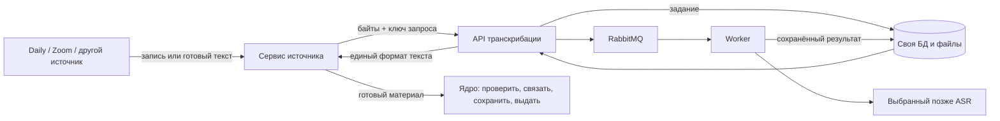

# Отдельный сервис транскрибации

Сервис принимает готовый текст или байты записи по HTTP. Он не знает кандидатов, вакансии, Daily/Zoom, API ядра и их ключи. Его можно выпускать отдельно от ядра и сервиса звонка.



Готовый VTT/SRT/JSON нормализуется сразу, без RabbitMQ и ASR. Для аудио/видео API сохраняет вход и задание; worker обращается к явно настроенному движку. Результат остаётся в собственной БД сервиса, а источник доставляет его в ядро. Успех распознавания и доставка в ядро — разные события.

**ASR по умолчанию выключен.** Ни провайдер, ни модель не выбраны; аудиозапрос без конфигурации получает 503. Реальные интервью в тестах не отправлялись.

- [Контракт API](CONTRACT.md): запросы, единый формат, повтор и неопределённый исход.
- [Запуск и выкатка](DEPLOYMENT.md): отдельный контейнер, состояние, секреты, порядок переключения.
- [Клиент источника](examples/source_client.py): upload → poll → result. Доставку в ядро реализует источник.

## Что выделено из прежнего кода

Парсер `interface-lab/server/materials_transcripts.py` перенесён в `src/md_transcription/normalization.py`; зависимость `pysubs2` теперь принадлежит сервису. В старом collector оставлен HTTP-клиент с прежней функцией `normalize_transcript`. Он не распознаёт аудио и не содержит локальный fallback. Сбой сервиса сохраняет исходный материал и переводит работу в повтор; повреждённый текст отклоняется отдельно.

Новый независимый сервис источника использует HTTP-контракт напрямую. Импорт пакета транскрибации в ядро не требуется. В двух старых интеграционных тестах парсер подключается как тестовая зависимость, чтобы отдельно проверять работу хранилища и collector.

## На чём собран сервис

Готовые библиотеки закрывают HTTP, валидацию, очередь, SQL и субтитры: FastAPI/Starlette/Pydantic/Uvicorn, Celery, SQLAlchemy, aiohttp, pysubs2. Их версии и транзитивные зависимости закреплены с хешами в `requirements.lock`. Собственный код отвечает за контракт результата, учёт владельца задания и восстановление после сбоев.

Решение о вынесении тяжёлой работы из HTTP-процесса опирается на [FastAPI](https://fastapi.tiangolo.com/tutorial/background-tasks/); потоковый приём — на [Starlette](https://www.starlette.io/requests/); повторная доставка — на [семантику задач Celery](https://docs.celeryq.dev/en/stable/userguide/tasks/). Для границы внешнего ASR изучены [Speaches](https://github.com/speaches-ai/speaches) и [Whisper ASR Webservice](https://github.com/ahmetoner/whisper-asr-webservice). Это примеры устройства inference API, а не выбранный нами движок. Полная карта заимствований и проверка библиотек приведены в обсуждении до реализации.

## Проверка

CPython 3.12; из этой папки после установки зависимостей:

```sh
PYTHONPATH=src python -B -m unittest discover -s tests -v
```

Тесты поднимают настоящий HTTP API отдельным процессом, загружают файл, запускают отдельный worker и проверяют результат после остановки тестового HTTP ASR и перезапуска API. Также проверяются изоляция клиентов, повторная доставка, конфликты входа, lease, неизвестный исход, ограничения размера и восстановление после оборванной загрузки.

Это проверка протокола и сохранности результата с искусственным ASR. Она не доказывает качество распознавания реальных интервью или работу RabbitMQ в production. Docker-образ и live-выкатка проверяются отдельно при интеграции.
